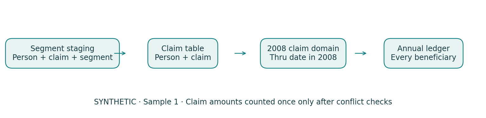
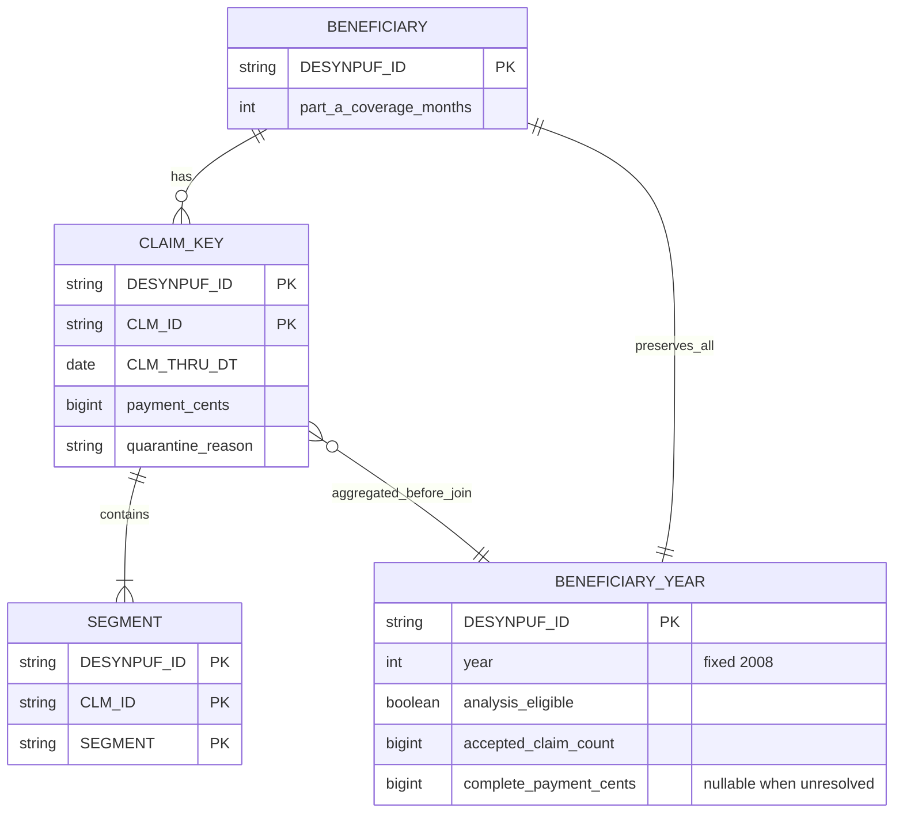

# Synthetic Medicare Claims Data Preparation & QC

**CMS DE-SynPUF · Sample 1 · 2008 claim-through-date domain · Fully synthetic**

A reproducible Python/DuckDB pipeline that turns synthetic segment records into
an audited claim table and a beneficiary-year ledger, without double counting
payments or dropping zero-claim beneficiaries. Independent portfolio work by
Xiangyi (Sam) Kong, October 2026; not Kaiser employment or real patient analysis.

[Two-page brief](reports/brief.pdf) · [HTML report](reports/report.html) ·
[Aggregate results](evidence/summary_tables.csv) · [中文说明](docs/README_CN.md)



## Verified results

| Layer / domain | Count | Meaning |
|---|---:|---|
| Full beneficiary ledger | 116,352 | All source 2008 synthetic people retained |
| Source inpatient segment rows | 66,773 | Three-year 2008-2010 file |
| Distinct claim keys | 66,705 | 68 claims have two segment rows |
| Quarantined claim keys | 67 | Conflicting fields across segments; all years |
| Original keys ending in 2008 | 27,496 | Before 21 annual conflicting claims excluded |
| Accepted claims ending in 2008 | 27,475 | Many-to-one join to full ledger |
| Complete-analysis beneficiaries | 116,331 | Excludes 21 flagged people from summaries |
| Complete-domain claims | 27,449 | Excludes 26 other claims of those 21 people |
| Complete-domain claimants | 15,724 | 13.52% of nonambiguous people |
| True zero-claim people | 100,607 | No accepted or potentially qualifying quarantine |

Mean **synthetic claim payment** per complete-domain beneficiary is **$2,185.66**,
median **$0**, p90 **$6,000** (includes true zeros). These are software/data-quality
illustrations, not real Medicare utilization, healthcare cost or annual incidence.
The 12-month Part A domain has 104,281 nonambiguous beneficiaries and a 14.68%
claimant share. Coverage sensitivity is explicit, not an after-the-fact denominator.

**Actual issue investigated:** 67 repeated claim keys have inconsistent nonmissing
fields (61 admission-date, 58 payment and 33 pass-through conflicts; overlapping
sets). They are quarantined in full, and affected 2008 people keep null complete
annual counts/amounts. No arbitrary segment-1/max selection and no double summing.
One repeated claim is consistent and is counted once after field checks. Details:
[segment policy](docs/segment_policy.md).

**Exact payment-definition finding:** on all 116,331 paired nonambiguous people,
`CLM_PMT_AMT + covered days × pass-through per diem`, aggregated by person,
reproduces source `MEDREIMB_IP` exactly. Payment-only sums fall short by $2,733,780.
The formula comes from the CMS codebook Appendix 2; equality was tested, not forced.
See [payment definitions](docs/payment_definition_note.md).

## Reproduce

Python 3.12; no R, cloud account, payment service or API key required.

```bash
python3 -m venv .venv
source .venv/bin/activate
pip install -r requirements.lock.txt
bash run_all.sh
python -m http.server 8000
# Open http://localhost:8000/reports/report.html
```

`PYTHON=/path/to/python bash run_all.sh` uses an existing environment. Initial run
retrieves two official CMS ZIPs and two official documentation PDFs, checks their
reviewed SHA256 hashes, and validates ZIP member names for the correct sample.
Changed/corrupt source bytes stop the run. Row-level raw and derived data stay
local; only aggregate evidence, code and reports are committed.

The entry point runs source verification -> string-first typed staging -> claim
resolution -> annual domain -> audited many-to-one join -> all-beneficiary ledger
-> independent SQL reconciliation -> tests -> aggregate HTML/PDF reports. A
failure removes publishable report/READY files and leaves a failed run log.
Twenty-five executable tests and sixteen independent count/payment identities
pass. Clean-directory reproduction and byte-identical aggregate tables are recorded
in `evidence/clean_run.json`. Environment/stage timing is in `evidence/run_log.json`.

## Data model and units



`SEGMENT` is a record-level key, not an independent claim. Diagram's audited
mapping means each segment belongs to a claim key; a claim may have up to two
segments. Claim keys need not correspond to separate hospitalization episodes.
Quarantined claims remain local with conflict flags and raw staging references.

All IDs remain strings (including leading zeros). Strict YYYYMMDD parsing preserves
raw values/status. Money is exact integer cents parsed via Decimal; no rounding
of extra precision and no floating equality. Negative payments are kept: 22 of
27,475 accepted 2008 claims are negative, 1,039 are zero, none are missing. Fault
fixtures additionally verify missing-payment behavior; they are not real-data
exceptions. Blank segment-level fields may be carried to claim grain only after
nonmissing consensus is proved. Conflicting fields themselves become null in
quarantine so even exception summaries cannot sum arbitrary candidate values.

Annual assignment is `CLM_THRU_DT` in 2008; 224 accepted claims cross calendar
years. Age is completed years on 2008-12-31, grouped <65 / 65-74 / 75-84 / 85+ /
Unknown. Birth/claim dates are synthetic. Coverage months are integer 0-12.

## Evidence and independent checks

- [Source manifest](evidence/source_manifest.csv): official URLs, UTC download
  timestamps, byte sizes, hashes and sample identity.
- [Data dictionary](docs/data_dictionary.csv), [metric dictionary](docs/metric_dictionary.csv),
  [contract](docs/schema_contract.json), [frozen scope and addendum](docs/scope.md).
- [Grain audit](evidence/grain_audit.csv), [field conflicts](evidence/segment_conflicts_by_field.csv),
  [date checks](evidence/date_qc.csv), [annual boundaries](evidence/year_boundary_summary.csv).
- [Join audit](evidence/join_audit.csv), [ledger reconciliation](evidence/aggregation_reconciliation.csv),
  [coverage sensitivity](evidence/coverage_sensitivity.csv), [quality checks](evidence/qc_results.csv).
- [DuckDB reconstruction](sql/reconcile.sql) derives accepted claim grain directly
  from staged segments, not the Python claim output. SQLite independently checks
  annual claim count, cents and claimant IDs. Python/DuckDB beneficiary counts and
  known-cent sums agree for every ID, not just aggregate totals.
- [Resume statements](docs/resume_bullets.md), [interview explanation](docs/interview_notes.md)
  and [limitations](docs/limitations.md) are tied to actual outputs.

The main summary excludes beneficiaries affected by unresolved annual claims.
The full ledger still contains them, with separate accepted counts/known sums,
quarantine counts, missing-payment counts and null complete totals. A true
zero-claim person is never inferred from a failed join or an unresolved claim.

## Source use and limits

Sources are the [CMS Sample 1 official download page](https://www.cms.gov/data-research/statistics-trends-and-reports/medicare-claims-synthetic-public-use-files/cms-2008-2010-data-entrepreneurs-synthetic-public-use-file-de-synpuf/de10-sample-1),
[CMS codebook](https://www.cms.gov/files/document/cms08-10desynpufcodebookpdf), and
[CMS user manual](https://www.cms.gov/research-statistics-data-and-systems/downloadable-public-use-files/synpufs/downloads/synpuf_dug.pdf).
CMS created DE-SynPUF for software development and research training. Synthesis
alters relationships between variables; it is not evidence about real healthcare
cost, disease burden, hospital quality or patient outcomes. No identification,
external identity linkage, hospital ranking, disease prediction or causal analysis.
Code is MIT; third-party source terms remain separate. Files are not redistributed.

## Extending the year

This is intentionally a fixed 2008 project. For a new year, obtain the SAME Sample
beneficiary file for that year, review the source lock, annual date and age
reference, update the schema/scope and SQL boundaries, re-audit segment conflicts,
then regenerate all outputs/tests. Do not attach three-year claims to 2008
attributes and relabel the result as another year. No weights from NHANES apply.
